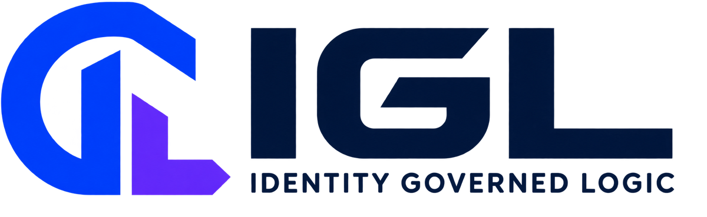

<p align="center">
  <picture>
    <source media="(prefers-color-scheme: dark)" srcset="docs/assets/igl-logo-dark.png">
    
  </picture>
</p>
<p align="center"><strong>The open-source runtime and the public API contract behind the IGL Governed Identity Platform.</strong><br><em>Status: experimental. Read the <a href="./docs/audit/SECURITY-AUDIT-2026-10.md">security audit</a> before you run the provisioning service anywhere other than your own machine.</em></p>

<p align="center">
  <a href="https://github.com/SMEPro-Technologies-LLC/igl/actions/workflows/ci.yml"></a>
  <a href="https://securityscorecards.dev/viewer/?uri=github.com/SMEPro-Technologies-LLC/igl"></a>
  <a href="./LICENSE"></a>
  <a href="./CHANGELOG.md"></a>
  <a href="https://id-me.ai"></a>
</p>

## What IGL is

IGL is a small programming language and a runtime for running AI and automated work under rules that are checked before the work happens, not after. Every program has to say who is acting, what that actor is allowed to do, and why the action is being taken. The runtime refuses anything that is missing one of those, and it writes a record of every step that cannot be edited afterwards without being detected.

In practice that means four things are always true for work run through IGL:

- **Identity.** You always know which person, organization or system did something.
- **Boundaries.** What an actor may do is declared up front and checked while the program runs. An action outside those limits does not run. There is no warning mode.
- **Intent.** The reason for each action is stored with it.
- **Trace.** Every step is written to an append-only journal where each entry is hashed together with the one before it. If any entry is changed later, verification fails and the journal refuses to load.

If you are not a developer: think of IGL as the rulebook and the referee for an AI system, both built into the system itself. The model does the thinking. IGL decides whether the model was allowed to, records what it did, and can prove that record was not tampered with.

## Three things live in this repository

**The runtime** is the IGL language and its reference implementation in Node.js: the lexer, parser and static checker, the interpreter, the identity-graph runtime, the hash-chained journal with Merkle inclusion proofs, signed receipts, and the governed decode bridge that keeps a language model's output inside the declared limits. Start with the [quick start](#quick-start) below and [`docs/SPEC.md`](./docs/SPEC.md).

**The platform contract** is the public OpenAPI 3.1 description of the IGL Governed Identity Platform served at [id-me.ai](https://id-me.ai). It covers identities, authority, knowledge, policies, evidence, outcomes, the graph, intelligence queries, agents, workflows, audit, and purpose-bounded projections. The contract does not depend on any particular model; Claude, Moonshot or another reasoning model can run underneath it without changing how applications call it. See [`spec/openapi.yaml`](./spec/openapi.yaml), [`spec/README.md`](./spec/README.md) and the [API reference](https://id-me.ai/#docs).

**The platform service** is the implementation of that contract: `platform/api`, a Cloudflare Worker with a D1 database per environment, deployed to `sandbox.id-me.ai` and `api.id-me.ai` from this repository by GitHub Actions. Its conformance suite runs all 46 operations against the service and checks every response against the contract. The public site at [id-me.ai](https://id-me.ai) is `platform/site`, also deployed from here. See [`platform/api/README.md`](./platform/api/README.md).

How the runtime and the platform fit together, including how runtime terms (BOUNDARY and FOOTPRINT graphs, journal, receipts, grants, observations) map to platform terms (the six graphs, purposes, projections, governance receipts), is written down once in [`docs/PLATFORM.md`](./docs/PLATFORM.md). Decisions that shaped either are recorded as [architecture decision records](./docs/adr/).

## What is in this repository

| Path | Contents |
|---|---|
| `src/` | The language core: lexer, parser, static checker, interpreter, identity-graph runtime, hash-chained journal (`store.js`), signed receipts and approvals (`sign.js`), governed decode bridge (`bridge.js`), per-token governed decode (`decode.js`) |
| `provision/` | The provisioning service: HTTP and MCP endpoints, authentication and rate limiting (`auth.mjs`), per-tenant graph storage (`registry.mjs`), persistent signing keys (`keys.mjs`), a plain-language attribute resolver, caller recognition (`whoami`), governed AI decode, the service's own OpenAPI file, a CLI, a Dockerfile, and IGL Studio (`studio.html`) |
| `spec/` | The platform contract, `openapi.yaml` (version 0.2.0), checked in CI and published at [id-me.ai](https://id-me.ai) |
| `platform/api/` | The hosted platform service that implements the contract (Cloudflare Worker, D1), with its conformance suite |
| `platform/site/` | The id-me.ai site, its generated API reference and the Contact Sales intake function |
| `programs/` | Reference IGL programs: a company BOUNDARY graph and an individual FOOTPRINT graph |
| `test/` | 148 tests: bridge, decode, extract, graph, igl, sign, store, security |
| `docs/` | Language specification (`SPEC.md`), graph model (`GRAPH.md`), decode bridge (`BRIDGE.md`), deliberate exclusions (`SCOPE.md`), platform mapping (`PLATFORM.md`), decision records (`adr/`), the security audit and its probes (`audit/`) |
| `examples/` | Runnable end-to-end flows, including journal persistence and replay |

## Quick start

You need Node.js 20 or newer.

```bash
git clone https://github.com/SMEPro-Technologies-LLC/igl.git
cd igl
npm ci
npm test
```

Run a governed program end to end. A small language model generates text inside the limits the program declares:

```bash
node examples/run-igl-language-live.mjs
```

Start the provisioning service. It listens on your own machine only (`127.0.0.1:8787`), serves IGL Studio at `/`, the HTTP API under `/api`, and MCP at `POST /mcp`:

```bash
npm run provision
```

Create an identity graph from a plain-language description:

```bash
node provision/cli.mjs "Example Energy, LLC is a Texas oil and gas operator"
```

Check the platform contract locally. This is the same check CI runs:

```bash
npx --yes @redocly/cli@1 lint spec/openapi.yaml
```

## Running the provisioning service for other people

By default the service only answers requests from the machine it runs on and needs no configuration. To make it reachable from elsewhere you have to set both of these, and the service refuses to start if the key is missing:

| Variable | What it does |
|---|---|
| `PROVISION_PUBLIC=1` | Listen on all interfaces instead of `127.0.0.1` |
| `PROVISION_API_KEY` | The service key. Required when public. Send it as `Authorization: Bearer <key>` |
| `PROVISION_ALLOWED_ORIGINS` | Comma-separated list of browser origins allowed to call the service. Empty means none |
| `PROVISION_RATE_BURST`, `PROVISION_RATE_PER_SEC` | Per-caller rate limit (default 60 requests, refilled at 1 per second) |
| `PROVISION_MAX_CONCURRENT`, `PROVISION_MAX_QUEUE` | How many model runs may happen at once and how many may wait (default 2 and 8) |
| `IGL_DATA_DIR` | Where journals, generated programs and keys are stored (default: the repository folder). Point it at a persistent volume in containers |
| `IGL_KEYS_DIR` | Where the service keeps its signing keys (default `<IGL_DATA_DIR>/keys`). Keep this directory private |

Registered callers present their own key as `Authorization: Bearer <key>` or `X-IGL-Caller-Key: <key>`. A key in the URL is ignored. Each caller sees only the graphs that belong to their tenant. Copy `provision/identities.example.mjs` to `provision/identities.mjs` to register callers; that file is ignored by git so real keys are never committed.

## What a program looks like

This is from `programs/jordan-avery-dfir-footprint.igl`, an individual FOOTPRINT graph:

```igl
ID[Jordan_Avery:DFIR_Coordinator | Action:draft-incident-report]
  :: Intent[Execute_DFIR_Action]
  => Context[Traces=None],
     Compute[
       AI.Extract(Slots=[dfir_action], Model=distilgpt2-local, Seed=9),
       ...
     ]
```

The same file contains a second statement that tries `Action:restore-production-systems`. The graph has seen that action happen five times, but nobody ever granted it. The runtime refuses the statement during authorization with `IGL_FOOTPRINT_DENIED`, before any model work is done. Having seen something happen is not the same as being allowed to do it.

## The four guarantees, stated plainly

1. **No identity, no execution.** The runtime will not run work for an actor it cannot identify.
2. **Actions outside the declared boundary do not run.** They are errors when the program is checked and again when it runs. They are never downgraded to warnings.
3. **Intent is part of the record.** Every trace entry carries the stated purpose it was executing under.
4. **The trace cannot be quietly altered, and it can be shared selectively.** Journal entries are SHA-256 hash-chained. A chain that was edited after capture fails verification and refuses to load. Merkle inclusion proofs let an auditor check one disclosed entry against a published root without seeing the rest of the journal. Every signed receipt carries the digest of the runtime build that produced it.

## How authority is decided

Authority comes from how knowledge entered the graph, never from what a payload says about itself.

| Layer | Meaning | Can it become authority? |
|---|---|---|
| `granted` | A grant signed by a registered grantor (for example a CISO office) | It is authority |
| `observed: governing` | A deterministic tool's attestation, anchored and replayable | Can be promoted, but is not authority yet |
| `observed: proposed` | Something a model said | Never. A model's output is not ground truth |

Grants must be signed with Ed25519 by a grantor the runtime knows about, and the signature is checked again every time a journal is replayed. The decode automaton, which limits what a model may emit, is compiled from granted knowledge only. When a trace has mixed provenance, the weakest link governs. The platform contract uses the same ladder: `seed`, `proposed`, `certified` on facts, evidence and relationships, and `attested` or `proposed` on obligations.

Attestations in a trace are classed as `ai` (nobody signed), `service` (a key the running service holds), or `human` (a registered person's key signed an approval of this exact statement). A program cannot claim a human approval just by naming a signer; it has to carry the approval as an input.

## Using IGL from an AI client

`provision/mcp.mjs` is a Model Context Protocol endpoint. An MCP client connects with a caller key and is recognized on first contact: the service seeds the caller's own identity graph from the registered profile, and on every later contact it replays the hash-chained journal. From then on the caller's grants and refusals govern every tool call in that session.

The tools this repository serves today are `check_health`, `list_graphs`, `get_graph`, `search`, `fetch`, `identity_graph_whoami` and `provision_identity`. The hosted platform's tools (`whoami`, `list_purposes`, `get_identity_context`, `explain_projection`, `list_obligations`, `search_graph`, `record_interaction`) are specified alongside their REST equivalents in [`docs/PLATFORM.md`](./docs/PLATFORM.md).

## Project links

- Platform and documentation: [id-me.ai](https://id-me.ai)
- Releases: tagged and signed. See [CHANGELOG.md](./CHANGELOG.md) and [GitHub Releases](https://github.com/SMEPro-Technologies-LLC/igl/releases)
- Getting help: [SUPPORT.md](./SUPPORT.md)
- Reporting a security problem: [SECURITY.md](./SECURITY.md). The latest audit is [docs/audit/SECURITY-AUDIT-2026-10.md](./docs/audit/SECURITY-AUDIT-2026-10.md)
- How decisions are made: [GOVERNANCE.md](./GOVERNANCE.md)
- Contributing: [CONTRIBUTING.md](./CONTRIBUTING.md)
- Roadmap: [issues labelled `roadmap`](https://github.com/SMEPro-Technologies-LLC/igl/issues?q=label%3Aroadmap). Planned but not yet in this repository: a WASM build with a browser playground, Python and TypeScript SDKs, and a policy-pack registry. This README only describes what exists.

## License and trademarks

- The code and the platform contract in this repository are licensed under the Apache License 2.0. See [LICENSE](./LICENSE).
- IGL, the IGL logo and "Identity Governed Logic" are trademarks of SMEPro Technologies LLC. See [TRADEMARK.md](./TRADEMARK.md). The license covers the code, not the name.
- Some of the governance mechanisms are the subject of pending patent applications. The patent grant in Apache 2.0 applies as written in the license.
- Contributions need a DCO sign-off. See [CONTRIBUTING.md](./CONTRIBUTING.md).
